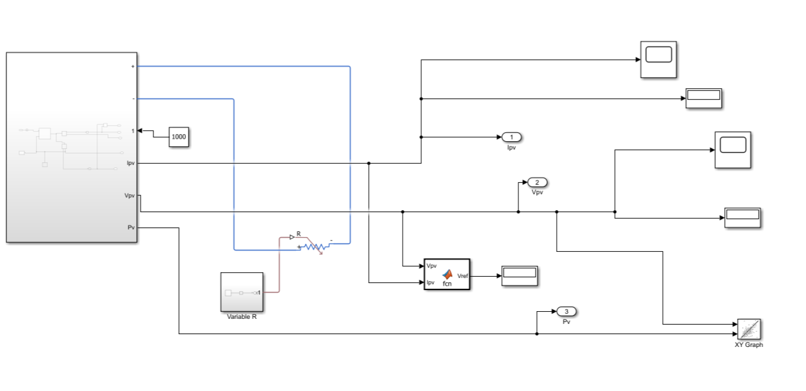

# Stand-Alone PV Energy System Using MATLAB/Simulink

A MATLAB/Simulink study of a stand-alone photovoltaic (PV) system. The supplied model measures PV voltage and current, obtains PV output power, varies the electrical load, displays signals, plots a PV characteristic, and includes a MATLAB Function block intended for Maximum Power Point Tracking (MPPT).

> **Project status:** The supplied model and screenshots demonstrate PV measurement and a P-V-style graph. The supplied MPPT function and its connection to the load need further work before this repository can claim a verified closed-loop MPPT result. The limitations are documented below.

## Table of contents

- [Objectives](#objectives)
- [Repository contents](#repository-contents)
- [System overview](#system-overview)
- [Simulink model analysis](#simulink-model-analysis)
- [PV mathematical model and characteristics](#pv-mathematical-model-and-characteristics)
- [Analysis of the supplied graph](#analysis-of-the-supplied-graph)
- [MPPT algorithm analysis](#mppt-algorithm-analysis)
- [How to run the model](#how-to-run-the-model)
- [How to complete the I-V and MPPT studies](#how-to-complete-the-i-v-and-mppt-studies)
- [Results and objective mapping](#results-and-objective-mapping)
- [Limitations and future improvements](#limitations-and-future-improvements)
- [Conclusion](#conclusion)

## Objectives

1. To find the voltage, current, and power of a given PV module.
2. To generate the I-V and P-V characteristics of the module.
3. To implement the Maximum Power Point Tracking algorithm.

## Repository contents

```text
standalone-pv-energy-system-mppt/
│
├── README.md
├── Solar.slx
└── images/
    ├── simulink-model.png
    └── pv-pv-characteristic.png
```

| File | Description |
|---|---|
| `Solar.slx` | MATLAB/Simulink model supplied for the PV system study |
| `images/simulink-model.png` | Screenshot of the top-level Simulink block diagram |
| `images/pv-pv-characteristic.png` | Screenshot of the simulation XY Graph |

## System overview

The model is organized around a PV subsystem, measurement signals, a variable-resistance load arrangement, displays/scopes, an XY Graph, and a MATLAB Function block.

At a high level, the intended study flow is:

```text
Solar irradiance
       |
       v
   PV subsystem
       |
       +------> PV voltage (Vpv)
       |
       +------> PV current (Ipv)
       |
       +------> PV power (Pv)
       |
       +------> Displays / scopes
       |
       +------> XY Graph (voltage-power characteristic)

Vpv and Ipv
       |
       v
 MATLAB Function
       |
       v
 Vref (reference-voltage output)
```

The diagram also shows a Variable Resistor driven by a separate `Variable R` control subsystem. In the supplied screenshot, the MATLAB Function's `Vref` output appears to be routed to a display; a feedback connection from `Vref` to the variable-resistor control is not evident.

## Simulink model analysis

### 1. PV subsystem

The large subsystem on the left represents the photovoltaic source. It has electrical positive and negative terminals and measurement outputs identified in the diagram, including `Ipv`, `Vpv`, and `Pv`.

A Constant block labelled `1000` is connected to the irradiance input. This indicates a solar irradiance input of **1000 W/m²** in the shown configuration.

The exact PV module rating, cell parameters, series/parallel configuration, temperature, and nameplate specifications are not provided in the screenshots. Those values should be read from the subsystem mask/block parameters before being stated as model specifications.

### 2. Voltage and current measurement

The PV subsystem exposes voltage and current signals:

- `Vpv`: PV terminal voltage, measured in volts (V).
- `Ipv`: PV output current, measured in amperes (A).

These signals are routed to displays and to the MATLAB Function block. The voltage and current are the quantities needed to calculate PV output power.

### 3. PV power

The model exposes a signal labelled `Pv`, representing PV power. The fundamental relationship is:

\[
P_{pv}=V_{pv}\times I_{pv}
\]

where:

- \(P_{pv}\) = PV output power in watts (W)
- \(V_{pv}\) = PV output voltage in volts (V)
- \(I_{pv}\) = PV output current in amperes (A)

If `Pv` is generated inside the PV subsystem, confirm its implementation and units in that subsystem. If it is calculated externally, use a Product block with `Vpv` and `Ipv` as inputs.

### 4. Variable-resistance load

The diagram contains a Variable Resistor and a subsystem labelled `Variable R`. The resistance is varied by a control signal. Changing the load changes the PV operating point, which changes measured voltage, current, and power.

This arrangement is useful for sweeping the operating point and observing PV characteristics. However, varying the load with a separate ramp is not, by itself, proof that the MPPT algorithm is controlling the load.

### 5. MATLAB Function block

The MATLAB Function block receives `Vpv` and `Ipv` and produces `Vref`. Its intended role is to calculate a reference voltage for MPPT.

The supplied code and its limitations are discussed in [MPPT algorithm analysis](#mppt-algorithm-analysis).

### 6. Displays, scopes, and XY Graph

Displays/scopes are used to observe signals during simulation. The XY Graph in the supplied top-level diagram appears to receive the voltage and power signals, making it consistent with a P-V plot. Confirm the X and Y input order in the actual block before interpreting the axes.

### Simulink block diagram



## PV mathematical model and characteristics

### Output power

The instantaneous electrical output power is:

\[
P_{pv}=V_{pv}I_{pv}
\]

For example, if the measured voltage is 24 V and measured current is 6.75 A, then:

\[
P_{pv}=24\times6.75=162\text{ W}
\]

This is only an arithmetic illustration. It is **not** a claim that the model produced exactly 24 V and 6.75 A.

### I-V characteristic

The I-V characteristic plots PV current against PV voltage:

- X-axis: \(V_{pv}\) (V)
- Y-axis: \(I_{pv}\) (A)

It describes how the PV module's output current changes with terminal voltage under a specified irradiance and temperature.

### P-V characteristic

The P-V characteristic plots PV power against PV voltage:

- X-axis: \(V_{pv}\) (V)
- Y-axis: \(P_{pv}\) (W)

The power rises as the operating voltage approaches the maximum-power region, reaches a peak, and then falls as the voltage approaches open-circuit voltage.

### Important PV terms

| Term | Meaning |
|---|---|
| \(V_{oc}\) | Open-circuit voltage: voltage when output current is zero |
| \(I_{sc}\) | Short-circuit current: current when terminal voltage is approximately zero |
| \(V_{MPP}\) | Voltage at the maximum power point |
| \(I_{MPP}\) | Current at the maximum power point |
| \(P_{MPP}\) | Maximum power, \(V_{MPP}\times I_{MPP}\) |
| Irradiance | Incident solar power per unit area, expressed in W/m² |

## Analysis of the supplied graph


The screenshot shows a curve that starts near the origin, rises to a broad maximum, and then falls steeply. This overall shape is consistent with a PV P-V characteristic.

Visual observations from the screenshot:

- The horizontal scale is approximately 0 to 30.
- The vertical scale is approximately 0 to 170.
- The visible peak is around horizontal value 24 and vertical value 162.

These are **approximate visual readings from the screenshot only**. The screenshot does not show axis titles, units, a data cursor, or exported simulation data. Therefore, do not report these estimates as exact measured values or as verified module ratings. Confirm that the graph X input is `Vpv` and the Y input is `Pv`, then export logged data to calculate the actual maximum.

The supplied screenshots show a P-V-style curve. A separate I-V graph is not included in the supplied images.

## MPPT algorithm analysis

### Purpose of MPPT

The Maximum Power Point Tracking technique is used to operate a PV source near the point at which it can deliver maximum electrical power under the current operating conditions. The maximum-power point can shift when environmental or operating conditions change.

### Supplied MATLAB Function code

The following is the code supplied with the project:

```matlab
function Vref = fcn(Vpv, Ipv)
V=52;
I=0.001;
c=0.11;
P=V*I;
Pnew=Vpv*Ipv;
if (Pnew>P)
    if (Vpv>V)
        Vpv=V+c;
    else
        Vpv=V-c;
    end
else
    if (Vpv<V)
        Vpv=V-c;
    else
        Vpv=V+c;
    end
end
V=Vpv;
I=Ipv;
P=Pnew;
Vref=Vpv
```

### Meaning of the variables in the supplied code

| Variable | Role in the supplied code |
|---|---|
| `Vpv` | Measured PV voltage input; it is also modified locally before output |
| `Ipv` | Measured PV current input |
| `V` | Local voltage variable initialized to 52 on each function call |
| `I` | Local current variable initialized to 0.001; subsequently assigned but not used in the decision |
| `c` | Voltage adjustment step, set to 0.11 |
| `P` | Local comparison power initialized as `V*I` |
| `Pnew` | Present measured power calculated as `Vpv*Ipv` |
| `Vref` | Function output |

The initial local power is:

\[
P=52\times0.001=0.052\text{ W}
\]

The present measured power is:

\[
P_{new}=V_{pv}I_{pv}
\]

The function compares `Pnew` with `P` and uses voltage comparisons to choose an increment or decrement of `c`.

### Critical code limitation

`V`, `I`, and `P` are initialized inside the function body on every execution. Their assignments near the end of the function do not preserve their values for the next call. Consequently, the function does not retain the previous sample's voltage and power.

A conventional Perturb and Observe (P&O) implementation needs to compare present power and voltage with values from the previous sample. The supplied function therefore should be described as an **MPPT-intended function**, not as a verified working P&O tracker.

The local variable `I` is assigned but does not contribute to subsequent decision logic. Also, the function modifies the local copy of `Vpv` and outputs that modified value as `Vref`; this does not change the measured PV voltage itself.

### MPPT control-path limitation

In the supplied top-level screenshot, `Vref` appears to connect to a display. The Variable Resistor appears to be driven by the separate `Variable R` subsystem. No clear connection from `Vref` to the load-control input is visible.

For closed-loop MPPT, the reference must be connected to an appropriate controller and actuator, such as a controlled DC-DC converter or a properly configured load controller. The complete feedback path must be tested before claiming successful MPPT operation.

### Suggested next implementation steps

1. Store previous voltage and power between function calls, using MATLAB `persistent` variables or Unit Delay blocks.
2. Implement the P&O decision using \(\Delta P=P(k)-P(k-1)\) and \(\Delta V=V(k)-V(k-1)\).
3. Add appropriate voltage-reference limits and choose a step size suitable for the model.
4. Connect the reference to a controller that can actually change the PV operating point.
5. Run the model and verify that the operating point approaches and remains near the measured P-V peak.
6. Compare power before and after enabling MPPT.

Do not claim MPPT performance until the closed-loop connection and simulation results have been verified.

## How to run the model

1. Install a MATLAB release compatible with the saved model and the required Simulink, Simscape, and Simscape Electrical products.
2. Clone or download this repository.
3. Open MATLAB and set the repository folder as the current folder.
4. Open `Solar.slx`.
5. If MATLAB reports missing libraries or compatibility issues, resolve those using the MATLAB release and toolboxes available on your computer.
6. Inspect the PV subsystem parameters, irradiance input, variable-resistor control, solver configuration, and simulation stop time.
7. Run the simulation.
8. Observe `Vpv`, `Ipv`, and `Pv` using the available displays/scopes.
9. Confirm the XY Graph input order and units.
10. Save the simulation results and export the logged signals for numerical analysis.

The model file has not been executed as a MATLAB simulation in the preparation of this README. The screenshots are the supplied visual evidence; numerical performance and runtime compatibility have not been independently verified here.

## How to complete the I-V and MPPT studies

### Generate the I-V curve

Configure an XY Graph (or MATLAB plot) with:

- X data: measured `Vpv`
- Y data: measured `Ipv`

Vary the load across the intended operating range, log the voltage and current, and plot the resulting paired samples. Label both axes with units.

### Generate the P-V curve

Configure an XY Graph (or MATLAB plot) with:

- X data: measured `Vpv`
- Y data: measured `Pv`

If power is not already calculated by the subsystem, calculate it from the synchronized voltage and current samples:

```matlab
Ppv = Vpv .* Ipv;
plot(Vpv, Ppv);
xlabel('PV Voltage (V)');
ylabel('PV Power (W)');
title('PV P-V Characteristic');
grid on;
```

### Calculate the maximum-power point from logged data

Once the simulation has logged synchronized vectors `Vpv` and `Ipv`, calculate:

```matlab
Ppv = Vpv .* Ipv;
[Pmpp, index] = max(Ppv);
Vmpp = Vpv(index);
Impp = Ipv(index);
```

The vectors must contain corresponding samples from the same simulation instants. Use the resulting values, rather than estimates from a screenshot, in the final report.

### Verify MPPT operation

After connecting and correcting the controller:

- Plot PV voltage, current, and power versus time.
- Plot the operating trajectory on the P-V curve.
- Check whether the operating point converges near the curve's maximum.
- Record steady-state power and any oscillation around the MPP.
- Repeat under changed irradiance and, if modelled, changed temperature.

## Results and objective mapping

| Project objective | Evidence in the supplied project | Current assessment |
|---|---|---|
| Find PV voltage, current, and power | Diagram exposes `Vpv`, `Ipv`, and `Pv` signals and includes displays/scopes | Measurement paths are present; exact numerical results should be logged from a run |
| Generate I-V and P-V characteristics | XY Graph is shown and a P-V-style screenshot is supplied | P-V-style result is supplied; separate I-V plot still needs to be generated and attached |
| Implement MPPT | MATLAB Function accepts `Vpv` and `Ipv`, and outputs `Vref` | MPPT intent is present; previous-sample memory and the closed-loop control connection need correction and verification |

## Limitations and future improvements

- Add axis labels and units to all graphs.
- Generate and include both I-V and P-V plots.
- Export simulation data and report exact \(V_{MPP}\), \(I_{MPP}\), and \(P_{MPP}\).
- Document PV module parameters, temperature, irradiance, and series/parallel configuration.
- Correct the MPPT function to retain previous-sample values.
- Connect the MPPT reference to a real control path.
- Compare operation with and without MPPT.
- Test multiple irradiance levels and temperature conditions, if supported by the model.
- Include time-domain plots showing convergence and steady-state behaviour.

## Conclusion

The supplied MATLAB/Simulink project is a starting point for studying a stand-alone PV energy system. The model diagram contains a PV subsystem, voltage/current/power signals, a variable-resistance load arrangement, displays/scopes, an XY Graph, and a MATLAB Function block intended to produce an MPPT reference voltage.

The supplied graph has the general shape of a PV P-V characteristic, with a visible peak. However, its axis units and exact data values are not available in the screenshot, and a separate I-V curve has not been supplied. The current MATLAB Function also reinitializes its comparison variables on every call, so it does not retain previous-sample data as required by a conventional P&O algorithm. In addition, the screenshot does not show the MPPT reference controlling the variable load.

Accordingly, the repository documents the PV model and initial characteristic study while identifying the work required to demonstrate verified closed-loop MPPT. Once the I-V graph, corrected controller, control connection, and logged simulation results are added, the project will provide stronger evidence for all three objectives.

## Technologies

- MATLAB
- Simulink
- Simscape / Simscape Electrical (as required by the model)
- MATLAB Function block
- Photovoltaic (PV) system modelling
- I-V and P-V characteristic analysis
- Maximum Power Point Tracking (MPPT)

## Keywords

`MATLAB` `Simulink` `Simscape` `Simscape-Electrical` `Solar-PV` `Photovoltaic` `Stand-Alone-PV` `IV-Curve` `PV-Curve` `MPPT` `Perturb-and-Observe` `Renewable-Energy`
